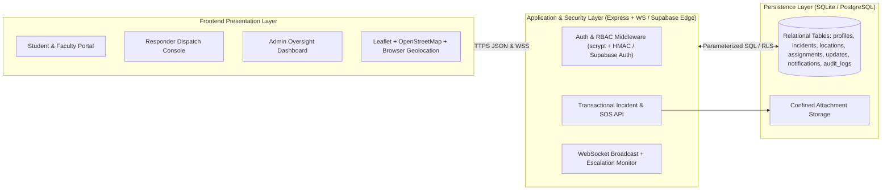
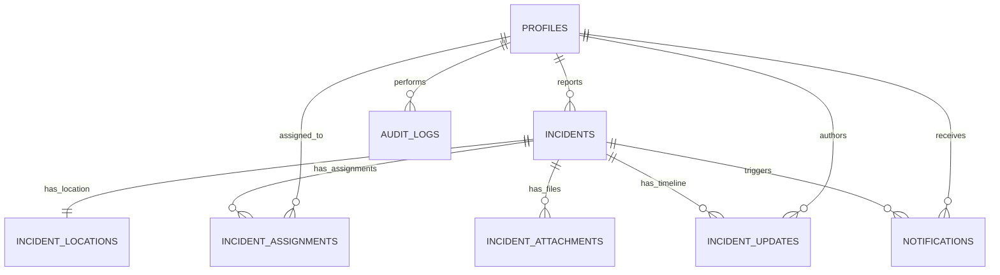
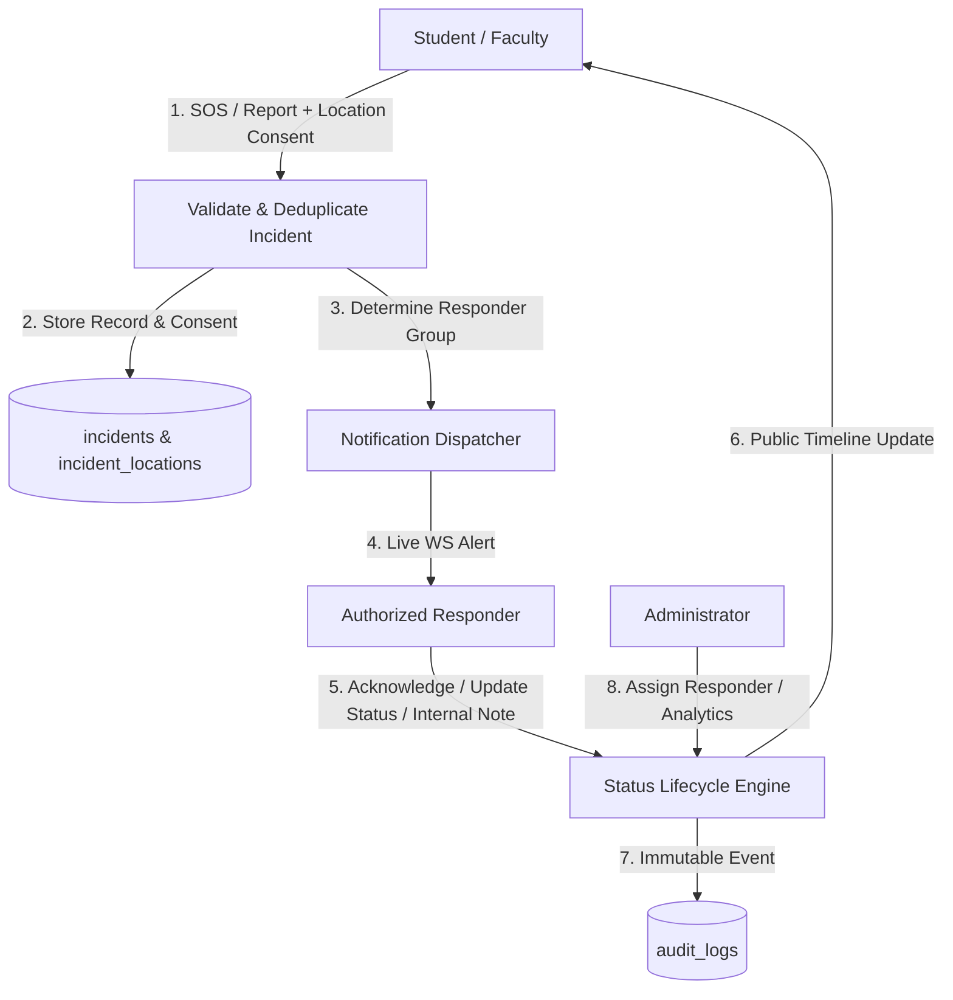
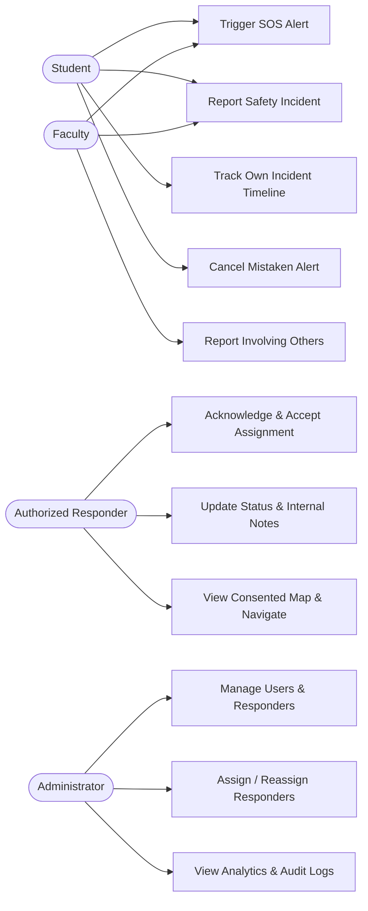

# Smart Campus Safety & Emergency Response System — Project Report, Diagrams, Test Plan & Deployment Guide

## 1. Abstract
Universities require fast, trustworthy, and privacy-respecting mechanisms to coordinate emergency response across expansive campuses. The **Smart Campus Safety & Emergency Response System** provides a centralized full-stack web platform connecting Students, Faculty, Authorized Responders, and Campus Administrators. Users can trigger duplicate-protected SOS emergency alerts or submit detailed incident reports across nine categories with explicit, consent-based browser geolocation and interactive OpenStreetMap pinning. Real-time WebSocket channels and automated escalation monitors alert authorized responders without exposing sensitive descriptions or private coordinates in public notifications. Role-Based Access Control (RBAC), `scrypt` password hashing, strict attachment validation, and immutable audit logs protect institutional data integrity from submission through resolution.

## 2. Introduction & Problem Statement
Traditional campus emergency workflows rely on fragmented phone trees, static web forms, or unauthenticated email inboxes. During high-stress situations, students and faculty struggle to communicate exact building locations, lack visibility into whether an alert was received, and risk duplicate submissions on unstable mobile networks. Responders lack unified dispatch maps and confidential internal coordination logs, while administrators lack real-time response-time analytics separated from drill/test data.

## 3. Objectives
1. Provide rapid SOS alerting and structured incident reporting accessible on mobile, tablet, and desktop.
2. Enforce explicit user consent before capturing GPS coordinates, with seamless manual location fallback.
3. Deliver real-time alerts and assignment workflows to authorized campus responders.
4. Track incident lifecycle transitions (`Submitted` → `Acknowledged` → `Assigned` → `In Progress` → `Resolved` → `Closed`, plus `Escalated` and `Cancelled`).
5. Protect sensitive personal, medical, and location data through server-side RBAC, PostgreSQL RLS, and audit logging.

## 4. Existing System vs. Proposed System
- **Existing System**: Manual phone calls, delayed email forms, zero live status tracking for reporters, no automated escalation, and mixed paper/spreadsheet records.
- **Proposed System**: Centralized web portal with one-click SOS confirmation, idempotency deduplication, consent-only GPS + Leaflet mapping, WebSocket live updates with polling fallback, automatic escalation thresholds, and clear separation between real incidents and academic test records.

## 5. System Architecture Diagram

## 6. Database ER Diagram

## 7. Data Flow Diagram (Level 1)

## 8. UML Use Case Diagram

## 9. Functional, Security, Reliability & Usability Test Cases

| Test ID | Category | Test Case Description | Expected Result | Verification |
| :--- | :--- | :--- | :--- | :--- |
| TC-F01 | Functional | First-run Admin claim and subsequent lock | First admin created; second claim rejected (`409`) | Verified in `authRoutes.ts` |
| TC-F02 | Functional | SOS alert with GPS consent and idempotency key | Single `SOS-YYYYMMDD-XXXX` created; retry returns deduplicated record | Verified in `SosModal.tsx` & `incidentRoutes.ts` |
| TC-F03 | Functional | Manual location fallback when GPS permission denied | Form accepts manual building description without failing | Verified in `SosModal.tsx` & `IncidentForm.tsx` |
| TC-F04 | Functional | Responder acknowledge, accept/decline, and status progression | Status updates propagate via WebSocket and timeline | Verified in `IncidentDetailView.tsx` |
| TC-S01 | Security | Student attempts self-registration with `role: "admin"` | Rejected with `403 Forbidden` and logged in `audit_logs` | Verified in `authRoutes.ts` |
| TC-S02 | Security | Student requests `/api/incidents/:id` belonging to another user | Rejected with `403 Forbidden` and audit log entry | Verified in `incidentRoutes.ts` |
| TC-S03 | Security | Student views incident with internal responder notes | `visibility = 'internal'` notes stripped from response | Verified in `incidentRoutes.ts` |
| TC-S04 | Security | Upload `.exe` or oversized (>5MB) attachment | Rejected by MIME + magic-byte + size validation | Verified in `incidentRoutes.ts` |
| TC-R01 | Reliability | Double-click Submit SOS button or network retry | Idempotency key prevents duplicate database records | Verified in `incidentRoutes.ts` |
| TC-R02 | Reliability | Unacknowledged SOS exceeds escalation threshold | Background monitor sets status to `Escalated` & notifies staff | Verified in `realtime.ts` |
| TC-R03 | Reliability | WebSocket connection drops mid-session | Client auto-reconnects and activates 15s polling fallback | Verified in `AuthContext.tsx` |
| TC-U01 | Usability | Mobile & keyboard navigation accessibility | Single-column responsive layout, visible focus rings, ARIA labels | Verified across components |

## 10. Deployment Guide (GitHub + Supabase + Static/Node Host)
1. **Source Control**: Push repository to GitHub; never commit `.env` or `./data/*.db`.
2. **Supabase Setup (Optional Managed PostgreSQL)**:
   - Create a Supabase project and run `/supabase/migrations/001_schema.sql` and `/supabase/migrations/002_rls_policies.sql` in the SQL Editor.
   - Deploy `/supabase/functions/submit-sos/index.ts` via `supabase functions deploy submit-sos`.
   - Enable Email/Password auth and configure Redirect URLs in Supabase Authentication.
3. **Full-Stack Node Deployment**:
   - Build frontend: `npm run build`
   - Set environment variables: `NODE_ENV=production`, `PORT=3000`, `SESSION_SECRET=<strong-random-hex>`, `ADMIN_BOOTSTRAP_PASSCODE=<passcode>`, and optional `SMTP_*` credentials.
   - Start server behind HTTPS reverse proxy: `npm start`.
4. **Safety Notice**: Do not connect automated external SMS/911 dispatch gateways until authorized by campus security leadership and verified in a controlled staging drill.

## 11. Limitations & Future Enhancements
- **Limitations**: External email delivery requires configuring real `SMTP_*` credentials in the server environment; GPS accuracy depends on device hardware and indoor signal conditions.
- **Future Enhancements**: Campus SSO/SAML integration, hardware blue-light beacon webhook ingestion, multi-campus tenant partitioning, and offline Service Worker SOS queuing.

## 12. Conclusion
The Smart Campus Safety & Emergency Response System delivers an end-to-end, security-hardened, and empirically verifiable platform ready for academic demonstration and controlled campus pilot deployment.
